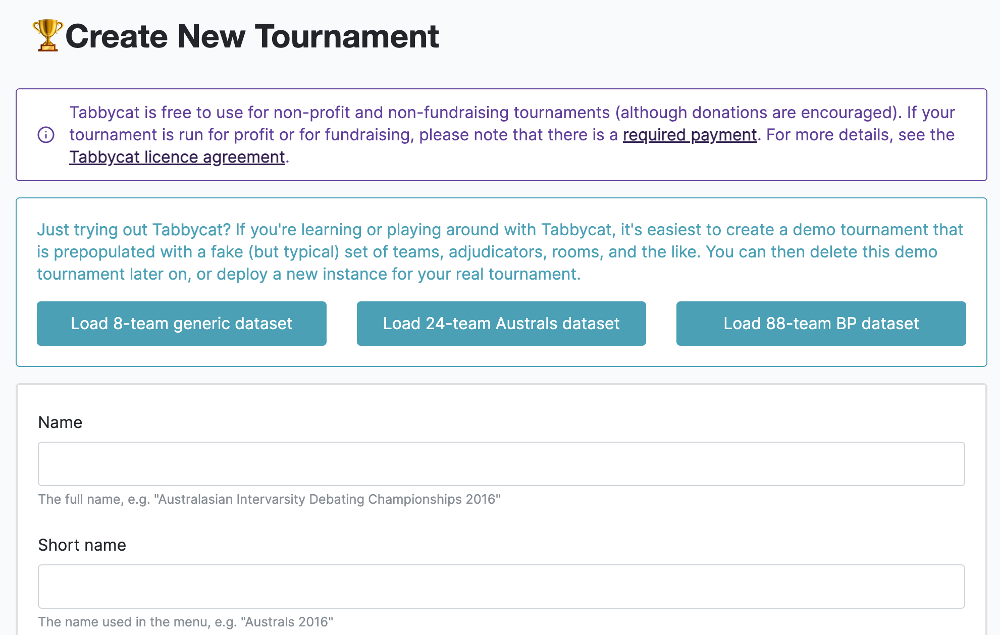
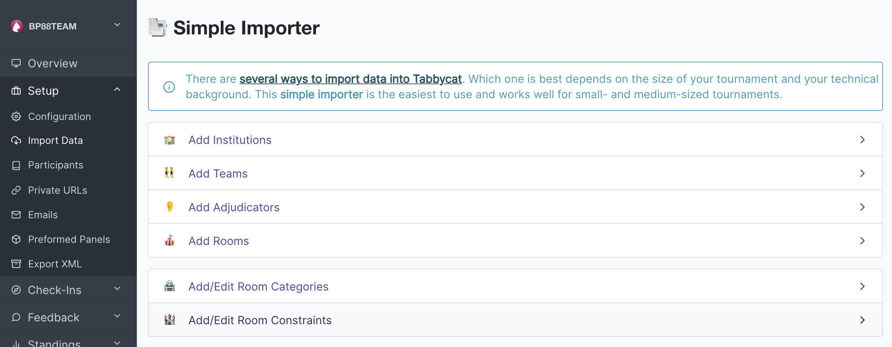
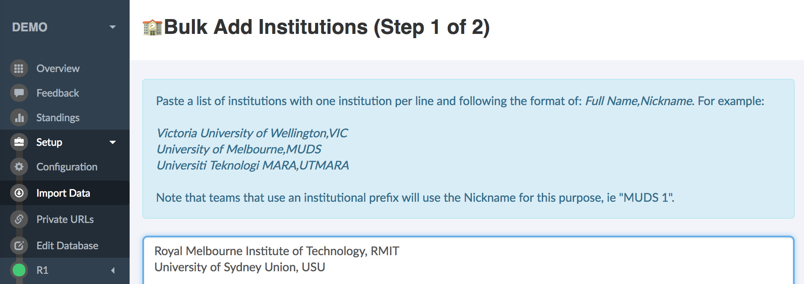
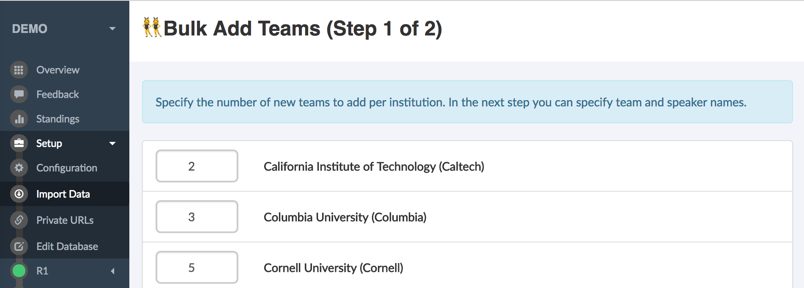
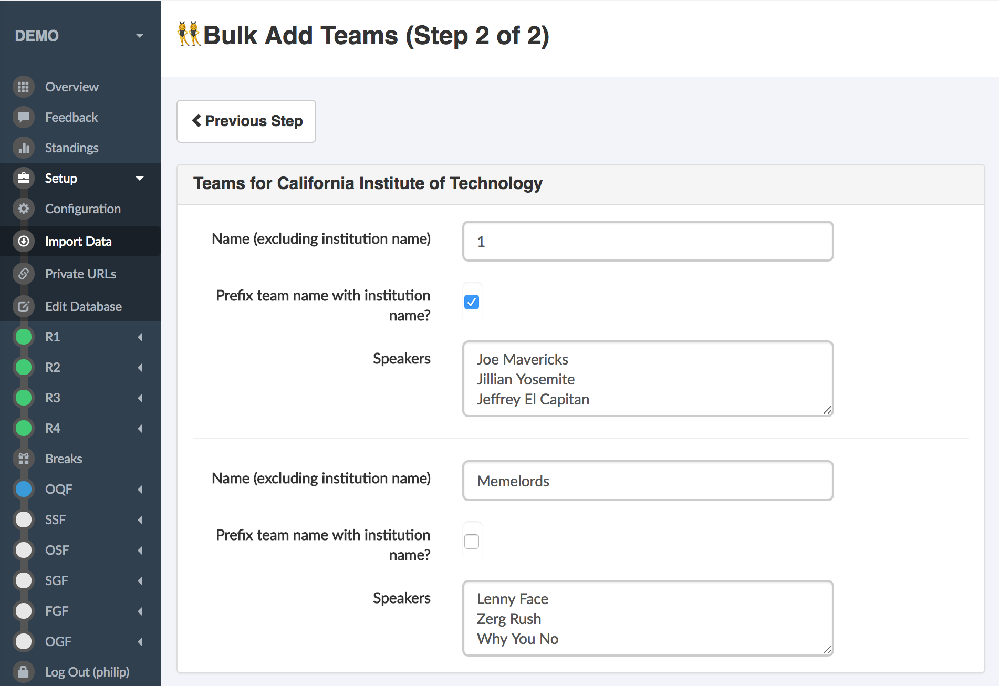

.. _importing-initial-data:

======================
Importing Initial Data
======================

Once you've got Tabbycat installed, the next step is to import data for the tournament: that is, import details of teams, speakers, adjudicators and rounds. There are a few ways to do this, each with their advantages and disadvantages.

To help you decide which to choose, here's a summary:

+----------------------+-------------------+--------------------+----------------------+
|        Method        |      Best for     |      Drawcard      |       Drawback       |
+======================+===================+====================+======================+
| **Demonstration      | Trying out        | Loads sample data  | Not for use with     |
| data**               | Tabbycat          | in one click       | real tournaments     |
|                      |                   |                    |                      |
+----------------------+-------------------+--------------------+----------------------+
| **Simple             | Small and         | Easy to use        | Only deals with      |
| importer**           | medium-sized      |                    | basic data           |
|                      | tournaments       |                    |                      |
+----------------------+-------------------+--------------------+----------------------+
| **Edit               | Adding data not   | Can handle all     | Adding large amounts |
| database**           | handled by the    | types of           | of data is time      |
|                      | simple importer   | information        | consuming            |
|                      | or editing        |                    |                      |
|                      | existing data     |                    |                      |
+----------------------+-------------------+--------------------+----------------------+
| ``importtournament`` | Large tournaments | Easier to repeat,  | Requires basic       |
| **command**          |                   | can handle most    | knowledge of how to  |
|                      |                   | formats of         | use a command line   |
|                      |                   | information        | interface            |
+----------------------+-------------------+--------------------+----------------------+
| **Developing your    | Large tournaments | Easier to repeat,  | Requires background  |
| own importer**       | with custom needs | will take          | in Python and        |
|                      |                   | information in     | and learning about   |
|                      |                   | whatever format it | the importer classes |
|                      |                   | is already in      |                      |
+----------------------+-------------------+--------------------+----------------------+
| **API**              | Tournaments with  | Less manual        | Requires programming |
|                      | external          | intervention       | knowledge or use of  |
|                      | registration      |                    | an existing external |
|                      | systems           |                    | application          |
+----------------------+-------------------+--------------------+----------------------+
| **Registration**     | Tournaments       | Less manual        |                      |
|                      | allowing self-    | intervention;      |                      |
|                      | registration      | user control       |                      |
+----------------------+-------------------+--------------------+----------------------+

Demonstration data
==================
If you're just learning or experimenting with Tabbycat, there are two demonstration datasets available, each with a sample set of teams, adjudicators, *etc.*, so that you can immediately start running rounds. Just be aware that these probably won't relate to anyone at your real-life tournament.

To load a demonstration dataset, click **New Tournament** link on the home page (once logged in as admin). You'll see a page titled "Create New Tournament". Scroll to the bottom of this page and click on one of the links at the bottom.

CSV importer
============

Open **Setup → Import Data → Simple Importer**, then select **CSV Importer**
from its own group at the top to upload team and speaker CSV files.
This importer supports arbitrary column headings: you choose what each column
means before creating participants. You can upload teams without speakers,
teams with numbered speaker name/email columns, or separate files containing
one speaker per row. The upload screen provides downloadable header-only CSV
templates for each of these layouts. Fill in your rows below the headers; add or
remove numbered speaker columns as needed.

For example, a team file can contain:

.. code-block:: text

    Team,Institution
    A,Example University
    B,Example University

A separate speaker file can link to those teams:

.. code-block:: text

    Name,Email,Team,Institution
    Alice,alice@example.com,A,Example University
    Bob,bob@example.com,B,Example University

Upload both files together, choose a format for each, and map the columns.
The importer suggests the file type from case-insensitive filename words such as
``teams`` and ``speakers``; you can change the suggested type. Each file has its
own mapping card, headed by its selected type. For team files, map any included
speaker columns to numbered speaker name/email fields. The preview derives the
number of speaker fields from these mappings, so no maximum speaker count is
required. A separate ``speakers.csv`` can use Anorak's ``team_name`` header in
place of ``Team`` in the example above.

Institutions are matched by their existing full names or codes. Confirm any
ambiguous matches in **Preview and edit rows**; create missing institutions with
the simple importer first, or explicitly select an existing institution or
**Unaffiliated** in the preview.
Separate speakers can link to teams already in the tournament or teams in the
same upload. If no team matches the name and institution, the preview proposes
creating a new team. Edit its name, institution and optional institutional prefix
there, or select an existing/uploaded team instead. Speaker rows sharing the same
team name and institution create one team, as in Anorak's ``import_speakers()``.
The importer creates uploaded team rows before their linked speakers, regardless
of upload order.

A file list shows each filename, type, row count and review status. Select a file
to map its columns or preview its rows; switching files preserves your edits.
Preview rows show compact summaries. Expand **Edit row** to correct values or
references, or check **Skip** for rows you do not want to import. Invalid rows open
automatically, and filters show rows needing attention or rows already skipped. Invalid rows must be corrected or skipped. Existing participants are
not overwritten. A separate speaker whose uploaded team is skipped or invalid is flagged before
confirmation. Correct the reference, fix the team, or skip the speaker as well.
If the linked team fails during execution, the speaker is reported as blocked. Blank numbered speaker groups do not create
placeholder speakers.

After reviewing the totals, confirm the import and click **Import pending rows**
on the results page. Keep that page open to see each row's progress and errors.
Each team and its inline speakers are saved together. If a request is interrupted,
check the affected row in Participants before starting another import; it may
already have been saved. The importer does not automatically retry uncertain
requests. Results can be downloaded as CSV.

Drafts are kept in your session and can disappear when it expires. Upload at most
20 files, each no larger than 2 MiB, with 1,000 data rows in total. Previews with
many columns may need smaller files to fit the server's form-field limit. UTF-8
and Windows-1252 encodings, comma/semicolon/tab delimiters, and a configurable
header row are supported. To import Google Sheets responses, download each
response tab as CSV first. Direct Sheets access and custom-question mappings
are not yet supported by this importer.

Simple importer
===============
The simple importer is the easiest way to get a tournament going, and we recommend it for small- and medium-sized tournaments. It allows you to add institutions, teams, adjudicators, venues, venue categories and venue constraints. (If you need to add anything else, use the :ref:`Edit Database area <import-edit-database>` instead.)

To get started, create a new tournament using the **New Tournament** link on the home page (once logged in as admin). It'll ask you for a few basic pieces of information.

Then, once you're in your tournament, click **Setup** in the left-hand menu, then **Import Data**, to open the simple importer.

You first need to add institutions. Once institutions are added, you can then add teams and adjudicators in the relevant sections. Each of these is a two-step process:

- For **institutions** and **venues**, it will first ask you to copy-paste a list of names and properties in a comma-separated table format.  The second step is to confirm individual fiels.
- For **teams** and **adjudicators**, it will first ask you how many teams/adjudicators to add for each institution (or who lack an institutional affiliation). The second step is to fill in their details, for example, names.

Finally, if you would like to use venue categories and/or :ref:`venue constraints <venue-constraints>`, you can do so using the two last sections of the simple importer.

.. note:: If copying and pasting from a spreadsheet, an easy way to make a comma-separated table is to save a spreadsheet with the relevant information as a \*.csv file, then open this file in a plain text editor (such as Notepad or TextEdit), and copying it from there.

.. _import-edit-database:

Editing the database
====================
Sometimes, the simple importer just isn't enough---whether because you need more customization than the simple importer handles (*e.g.* adjudicator feedback questions), or because some participants changed their details after you imported the inital data. In this case, the easiest thing to do is to edit the database via the Django administrative interface (under Setup > Edit Database).

The general pattern goes like this: Go to **Setup > Edit Database**, find the type of object you wish to add/change, and click "Add" or "Change". Then, fill in what you need to and save the object.

.. caution:: The Edit Database area is very powerful, and naturally if you mess things up, you can insert potentially catastrophic inconsistencies into the database. For participant information this is hard to do, but it's worth keeping in mind.

.. _importtournament-command:

The ``importtournament`` command on local installations
=======================================================

We've written a management command called ``importtournament`` to help automate the tournament set-up. The script, however, is neither foolproof nor comprehensive, so you might find you need to modify things slightly if your tournament structure is different from ours. Be prepared to try this a few times to get it to work. Nonetheless, this is probably the fastest way to set up a tournament.

1. Copy and rename the ``data/demo`` folder
2. See the CSV files in the new folder, and add/replace the data as per your tournament. Note that the institutions (*i.e.* first column) in the ``speakers.csv`` and ``adjudicators.csv`` files must match the institutions in the second column of the ``institutions.csv`` file. And that all CSV files must end with a blank line.
3. Use this command, replacing ``YOUR_DATA_DIR`` with your new folder's name. (Square brackets indicate optional arguments; if you use them, omit the square brackets. All of them relate to the name of your tournament.)

::

  $ ./manage.py importtournament YOUR_DATA_DIR [--slug SLUG] [--short-name SHORT_NAME] [--name FULL_NAME]

This script has a number of options. They're worth taking a look at before you run the script. For details, see::

  $ ./manage.py importtournament --help

4. Assuming the command completes successfully without errors, you should double check the data in the Django interface, as described above in :ref:`import-edit-database`. In particular you should check that the *Rounds* have the correct draw types and that silent rounds have been marked correctly.

``importtournament`` on Heroku installs
========================================

If you want to use the ``importtournament`` command locally but then upload that data to Heroku, you can do so with these instructions.

.. danger:: This step wipes the Heroku database clean, and replaces it with the contents of your local database. If you have any data on the Heroku site that isn't also in your local database, **that data will be lost** and will not be recoverable.

.. tip:: If you have multiple Heroku sites, you may find that the ``heroku`` commands refuse to run, prompting you to specify an app. If so, add ``--app yourappname`` to each ``heroku`` command.

a. Enable maintenance mode on Heroku. This takes the site offline, to ensure that no-one can possibly create or change any data on the site while you're pushing a new database up::

    heroku maintenance:on

b. Reset the database. (Caution: This permanently deletes all information on your Heroku database!)

  ::

    heroku pg:reset

c. Push your local database to Heroku::

    heroku pg:push yourlocaldatabasename DATABASE

  You might need to specify your local PostgreSQL credentials by adding ``PGUSER=yourusername PGPASSWORD=******** PGHOST=localhost`` to the *beginning* of that command. (This sets environment variables to those values for the duration of that one command.)

d. Disable maintenance mode::

    heroku maintenance:off

Developing your own importer
============================

If our suggested file formats cause you headaches, it might be easier to write your own importer. We have a generic importer framework that should make this easier, so for some tournaments it might (very conceivably) be faster to write your own importer to conform to your data, than it is to make your data conform to our importer. You need a background in Python in order to do this. For more details, see :ref:`tournament-data-importers`.

Application Programming Interface (API)
=======================================

Participants can be imported in Tabbycat through the :ref:`API <api>`, using authenticated endpoints making ``POST`` requests to the relevant endpoints. There may be tournament registration software which interfaces with Tabbycat, or you may have to program one yourself, in any language.

Participant self-registration
=============================

Tabbycat has an inbuilt system for participants to self-register which is customisable to the tournament's workflow.

The basic functionality is activated by activating the open team and adjudicator registration in the "Registration" section of the settings. You can also choose which fields they will be asked and how their team name will be constructed. Then, people will find a link on the tournament's main page allowing themselves to register.

Registration statuses can be checked under the Registration tab in the admin sidebar, and each page will also allow custom questions to be added to the relevant registration form.

For intervarsity or slot-controlled tournaments, institutional registration with a coach can be required and optionally require them to request a certain number of teams and adjudicators. In the admin institutional registration list, users can set the number of approved participants. The coach will then be able to register their members.

To ease registration by participants, coaches have "invitation links" generated for them to give out, allowing their members to register as a team or adjudicator. When a team does not have a complete set of speakers, an invitation link is also generated to allow the registered speaker to "invite" their teammates.
